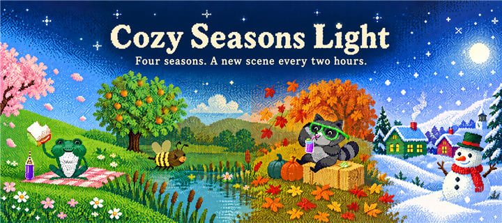
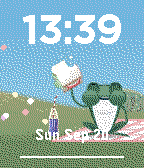
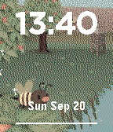
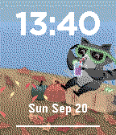
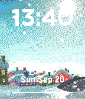
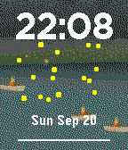
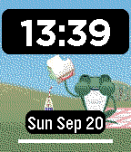

# Cozy Seasons Light



[Install from the Pebble Appstore](https://apps.repebble.com/d343af2118ad469280a94611)

Version **1.1.0**. A seasonal watchface for Pebble Time / Time Steel (Basalt, 144 x 168).

The smaller-download companion to [Cozy Seasons](https://github.com/bcrowell770/Cozy-Seasons), with 48 backgrounds instead of 96. Each scene displays for two hours. The editions have separate app identities and can coexist.

## Features

- 12 original-quality backgrounds per season
- Tap/shake animations: spring petals, summer seeds by day and fireflies at night, autumn leaves, winter snow
- Automatic, manual, and daily random season selection
- 12-hour and 24-hour time, custom text color, optional date
- Low Vision Mode, battery bar, optional Bluetooth disconnect icon and vibration
- Clay configuration

## Screenshots

Actual Basalt emulator captures at native resolution:








## Build

With Node/npm and the Pebble SDK installed, run from this folder (WSL is supported):

```sh
npm ci
pebble build
```

Output: `build/Cozy Seasons Light.pbw`. Install from the store link above or sideload your local build.

The verified SDK 4.17 build has a 349,679-byte resource pack and emits its 256 KB publication-limit warning. Emulator installation and screenshots were verified; these are not measurements of physical Time 1 installation reliability.

## Source

- `src/c/main.c`: SDK build source, layout, backgrounds, and effects
- `src/pkjs/`: settings and JavaScript
- `package.json`: Light UUID, version, and 48-background manifest
- `main.c` and `src/main.c`: mirrored sources retained from the original project
- `store-assets/`: promotional artwork and screenshots

See [CHANGELOG.md](CHANGELOG.md) for version history. Light 1.1.0 includes the botanical particle improvements from regular Cozy Seasons 1.4.0.

## License and credits

MIT License, copyright 2026 BD Crowell. See [LICENSE](LICENSE).

Built with the Pebble SDK and Rebble Clay. Thanks to the Pebble and Rebble community.
